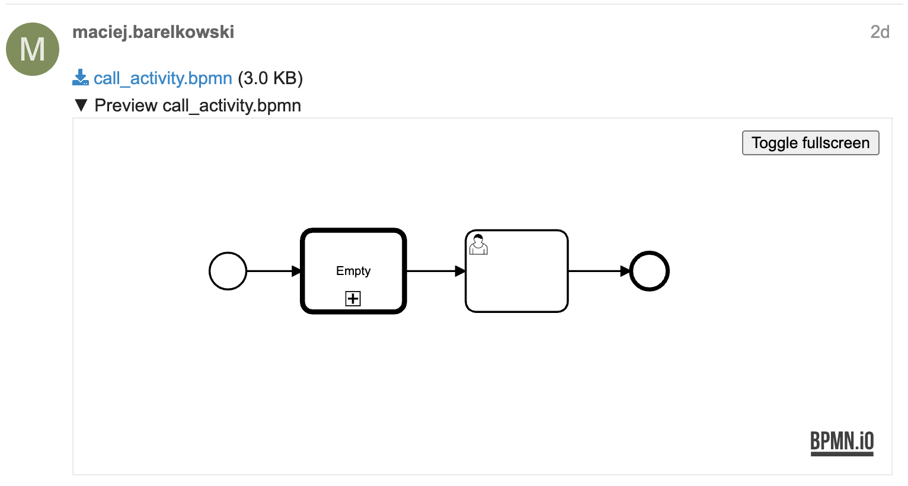

# discourse-bpmn-io



Display attached BPMN and DMN diagrams on [Discourse](https://www.discourse.org/).

Every `.bpmn` and `.dmn` attachment in a post gets a collapsible preview right below the download link. Diagrams are rendered with [bpmn-js](https://github.com/bpmn-io/bpmn-js) and [dmn-js](https://github.com/bpmn-io/dmn-js). Readers can:

- pan the diagram and zoom with the mouse wheel, the zoom buttons or the zoom slider
- fit the diagram to the preview
- find their way around large diagrams with a [minimap](https://github.com/bpmn-io/diagram-js-minimap)
- open DMN decisions to see their decision tables
- switch the preview to fullscreen

## Installation

Follow the [plugin installation guide](https://meta.discourse.org/t/install-plugins-in-discourse/19157) and add this repository to the `after_code` hook of your `app.yml`:

```yaml
hooks:
  after_code:
    - exec:
        cd: $home/plugins
        cmd:
          - git clone https://github.com/barmac/discourse-bpmn-io.git
```

Then rebuild the container with `./launcher rebuild app`.

## Configuration

- Allow uploading the diagrams by adding `bpmn` and `dmn` to the **authorized extensions** site setting.
- Previews can be turned off with the **discourse bpmn io enabled** site setting.

Previews are not shown in the mobile view.

## How it works

Discourse protects its pages with a strict [Content Security Policy](https://meta.discourse.org/t/mitigate-xss-attacks-with-content-security-policy/104243) that only allows scripts carrying a per-request nonce. To stay compatible with it, the diagram is not rendered in the forum page itself. Instead, the preview is a sandboxed `<iframe>` that loads a static viewer page shipped with the plugin (`public/viewer`, served at `/plugins/discourse-bpmn-io/viewer/`):

- The viewer page and the bpmn-js / dmn-js builds it uses are served by your forum. No third-party CDN is involved.
- The iframe runs without `allow-same-origin`, so the viewer cannot access the forum or the visitor's session.
- The forum downloads the attachment and passes it to the viewer via `postMessage`.

## Development

You need Node.js 22+ and [pnpm](https://pnpm.io/) 12.

```sh
pnpm install
pnpm lint          # all linters
pnpm lint:fix
```

The system specs in `spec/system` run inside a Discourse development environment:

```sh
LOAD_PLUGINS=1 bin/rspec plugins/discourse-bpmn-io/spec/system
```

### Updating the viewer

`public/viewer/viewer.{js,css}` are written by hand. Everything else in `public/viewer` and `assets/javascripts/discourse/lib/bpmn-io-viewer-urls.js` is generated by `pnpm build:viewer` from the `bpmn-js`, `dmn-js` and `diagram-js-minimap` packages in `node_modules`. The generated files are committed, as Discourse installs plugins without a build step.

To update these libraries:

```sh
pnpm add --save-dev --save-exact bpmn-js@<version> dmn-js@<version> diagram-js-minimap@<version>
pnpm build:viewer
```

Run `pnpm build:viewer` again after editing `viewer.js` or `viewer.css`, and commit the result. All generated URLs contain a content hash, so browsers pick up the new files despite the long-lived caching headers Discourse uses for plugin assets. CI fails when the committed build is out of date.

## License

[MIT](./LICENSE)

The bundled builds of bpmn-js and dmn-js are distributed under the [bpmn.io license](./public/viewer/vendor/), which requires the bpmn.io watermark to stay visible on rendered diagrams. diagram-js-minimap is MIT licensed.
